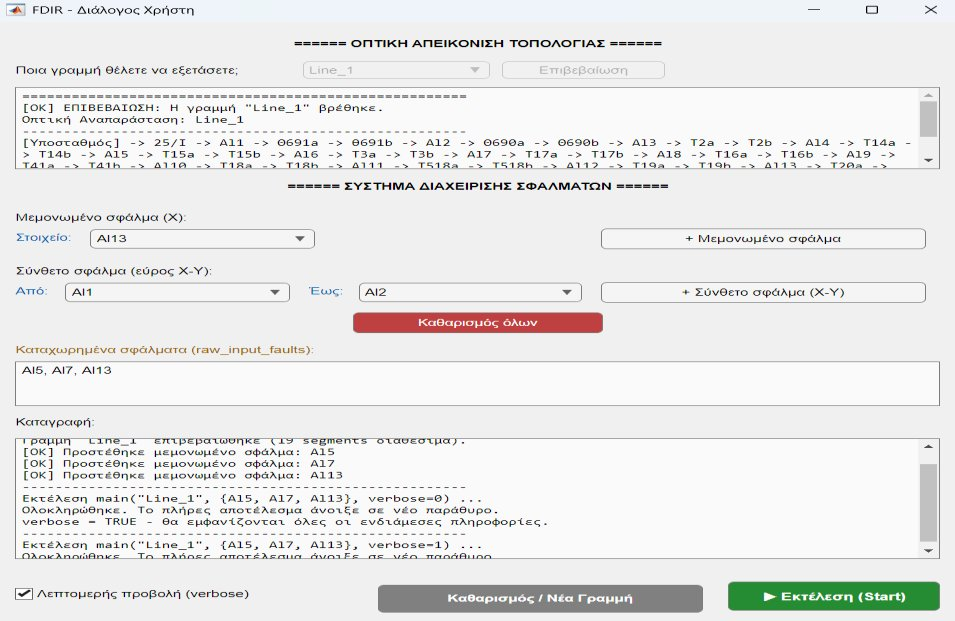
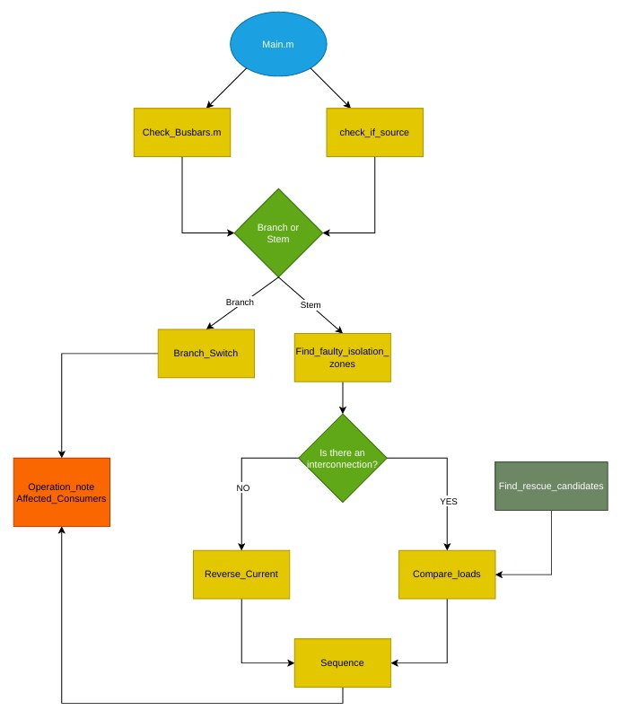
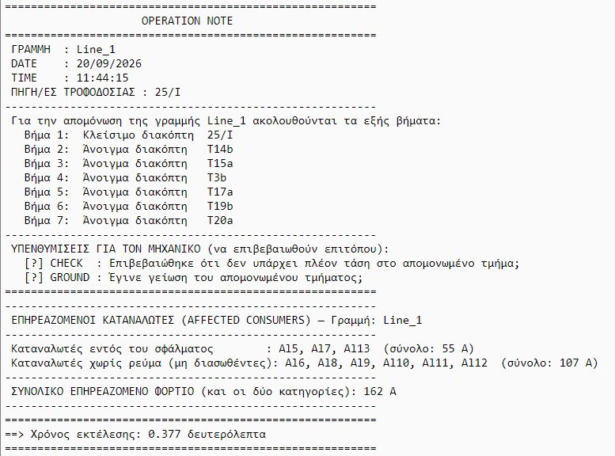

# Automated Switching Orders for MV Distribution Networks

MATLAB application that automatically writes the **switching sequence (operation note)** for scheduled outages on a medium-voltage (MV) underground distribution network.

Diploma thesis, Department of Electrical & Computer Engineering, University of Western Macedonia (2026).
Supervisor: Assoc. Prof. Dimitrios Stimoniaris.



## What it does

When an engineer plans an outage on part of an MV line, the program:

1. Reads the network topology and element data (switches, segments, loads, breaker capacities) from an Excel database built from the AutoCAD single-line diagrams.
2. Checks which busbars are energised and from where (`Check_Busbars`, `check_if_source`).
3. Classifies the line as **stem** or **branch** and opens the nearest switching devices on each side of the requested sections (`Branch_Switch`, `find_faulty_isolation_zones`).
4. Searches for **alternative supply** for the de-energised ("orphan") sections through neighbouring lines and busbars (`Reverse_Current`, `find_rescue_candidates`, `compare_loads`). A path is accepted only if every breaker in the chain has enough spare capacity.
5. Builds the full step-by-step sequence with the **CHECK** (absence of voltage) and **GROUND** safety steps (`Sequence`, `Operation_Note`) and lists the affected consumers (`Affected_Consumers`).



## How to run

Requirements: a recent MATLAB version (the interface uses `uifigure` components).

1. Download or clone this repository.
2. In MATLAB, set the **repository folder** as the current folder (the program looks for `Database/Elements_Data.xlsx` relative to it).
3. Run:

```matlab
run_fdir
```

4. In the window: choose a line, confirm it, add the sections to isolate (single section or range) and press **Start**.

The full operation note opens in a new window.



## Repository structure

| Folder / file | Content |
|---|---|
| `run_fdir.m` | Starts the application |
| `Functions/` | All algorithm functions and the GUI (`FDIR_Dialog_GUI.m`) |
| `Scripts/dialog.m` | Original launch script |
| `Database/Elements_Data.xlsx` | Network database: sheet 1 = line topology, sheet 2 = element type, state, load, capacity, link |

## Notes

- The user interface and the operation note are in Greek, following the format used by the Greek distribution operator.
- The element names in the Excel file are renamed and do not identify the real network.

## Author

Leonidas Zettas · [LinkedIn](https://www.linkedin.com/in/leonidas-zettas) · zettasleonidas@gmail.com
